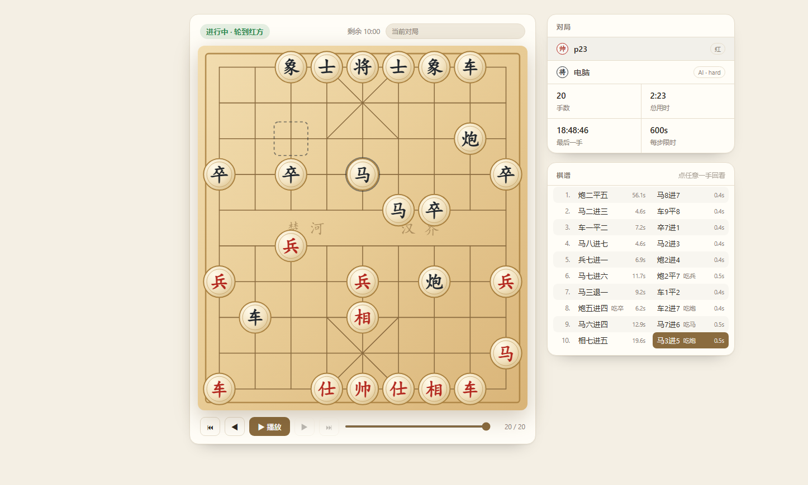

# 象棋对战服务端



面向 **LLM 与人类** 的中国象棋 HTTP 对战服务：单文件 Python（标准库 HTTP 服务），
内置完整规则、长轮询通知、Pikafish 引擎、棋谱回放页与浏览器可看的对局列表。

线上实例：私有部署（systemd 托管，端口 5040）
客户端技能：`client/xiangqi/`（可直接拷进 `shell-skills-gitea` 技能仓库）

## 特性

- **规则完整**：全部走法生成 + 将帅照面 + 将军/将死/困毙判定，服务端是唯一裁判
- **省 token**：棋盘唯一表示、合法走法空格分隔、长轮询一步一请求、事件按需裁剪
- **人机对战**：自带纯 Python 引擎（random/greedy/depth2）+ 可接 [Pikafish](https://github.com/official-pikafish/Pikafish) 四档（easy/normal/hard/max），全程 0 token
- **对局可恢复**：每步原子落盘，进程重启后棋盘/回合/席位/计时都能接上；断线可用 `player` 或同名重连
- **幂等重发**：同一手重复提交（没收到响应就重试）返回上次回执并标 `duplicate`，不报错
- **棋谱与回放**：每局归档 `xiangqi_games/<gid>.json`，`/history` 对程序返回 JSON、对浏览器返回棋盘回放页（可播放/逐步/点棋谱跳转），顶栏可切换历史对局
- **回放页事件驱动**：页面挂一条 `/watch` 长轮询，一落子立刻刷新（实测 0.6s），不用手动刷新、也不是定时轮询；看历史对局时不跟随
- **中文记谱**：每手都带 `notation`（`炮二平五` / `炮8平5`），红方汉字数字、黑方阿拉伯数字
- **终局方式**：将死、困毙、超时、认输、长将判负、双方同意和棋

## 快速开始

```bash
python3 server/xiangqi_server.py --port 5040
# 或者起人机局（你执红先行，电脑执黑）
python3 server/xiangqi_server.py --port 5040 --engine hard
```

打开 <http://127.0.0.1:5040/> 是 Markdown 规则说明，`/history` 是回放页。

```bash
# 人机开局
curl -s -X POST localhost:5040/join -H 'Content-Type: application/json' \
     -d '{"name":"我","vs":"engine","level":"hard"}'

# 走一手（wait=60 表示走完挂起等对手，一步一请求）
curl -s -X POST localhost:5040/move -H 'Content-Type: application/json' \
     -d '{"player":"p1","move":"h2e2","wait":60}'
```

## 目录

```
server/xiangqi_server.py   服务端主体（规则 + 对局 + HTTP 路由 + 回放页）
server/xiangqi_engine.py   内置纯 Python 引擎（random / greedy / depth2）
server/pikafish_uci.py     Pikafish UCI 适配层（常驻子进程、FEN 转换、崩溃自愈）
client/xiangqi/            客户端技能（skill.py + config.example.json，可整目录拷进 shell-skills 仓库）
tests/*_test.py            十套测试，共 300+ 项断言，全本地跑，不碰线上
deploy/xiangqi.service     systemd 单元示例
```

## 棋盘与坐标

```
   a b c d e f g h i      ← 列 a-i 从左到右
 9 r n b a k a b n r      ← 行 9 = 黑方底线（屏幕上方）
 8 . . . . . . . . .
 …
 0 R N B A K A B N R      ← 行 0 = 红方底线（屏幕下方）
```

- **大写是红方**（`K`帅 `A`仕 `B`相 `N`马 `R`车 `C`炮 `P`兵），**小写是黑方**（`k`将 `a`士 `b`象 `n`马 `r`车 `c`炮 `p`卒），`.` 空点
- 走法 4 字符 `起点列行+终点列行`，如 `h2e2` = 炮二平五；`h2-e2`、大写、空格都会被归一化
- 上面的示意是**红方视角**。`/state?player=<黑方 token>` 返回的 `board` 是**黑方视角**：
  行列同时反转（180° 旋转，行 0 在上、i 列在左），但**行列标签仍是真实坐标**，所以走法不用换算；
  红方 token 和不带 `player` 的请求保持红方视角

## 接口

| 方法 | 路径 | 说明 |
|---|---|---|
| POST | `/join` | 入座/重连。`{"name"}`，人机加 `{"vs":"engine","level":"hard"}`，`step` 设每步限时（默认 300 秒，空桌第一人生效）；返回 `player` / `side` / `step_s` / `board_legend` |
| GET | `/state?player=p1` | 局面快照。**合法走法只给该走棋的一方**；`board` 按执方视角（黑方为 180° 旋转，标签仍是真实坐标） |
| GET | `/wait?player=p1&since=<ply>&timeout=50` | 长轮询，事件：`your_turn` / `opponent_moved` / `draw_offer` / `timeout_warning` / `game_over` |
| POST | `/move` | 走棋，`{"player","move","wait"?}`；非法走法返回 400 并附当前合法走法 |
| POST | `/draw` | 求和：`{"player"}` 提议，对手 `{"player","accept":true|false}` 同意/反对 |
| POST | `/resign` | 认输 |
| POST | `/reset` | 重开；`{"clear":true}` 清桌（连机器席位一起清） |
| GET | `/history[?game=<gid>]` | 棋谱：程序拿 JSON 数组，浏览器拿回放页（`?format=json/html` 可强制） |
| GET | `/games` | 历史对局索引（不含走法） |
| GET | `/meta` | 页面对局卡片元信息：席位名 / 人机模式 / 每步限时（不含 token） |
| GET | `/watch?since=<ply>&st=<status>&timeout=25` | 回放页自动刷新用的长轮询：手数或状态变化才返回 |

### 状态字段

```json
{
  "status": "playing", "turn": "black",
  "board": "   a b c ...", "in_check": false,
  "legal_moves": "a0a1 a0a2 ...", "moves_for": "black",
  "last_move": {"ply":5,"by":"red","move":"h2e2","notation":"炮二平五"},
  "remaining_ms": 58210,
  "you": {"side": "black", "is_turn": true}
}
```

- `status`：`waiting` / `playing` / `red_win` / `black_win` / `draw`
- `end_reason`：`checkmate` / `stalemate` / `timeout` / `resign` / `perpetual_check` / `agreement`
- **`legal_moves` 的归属**：带 `player` 且轮到你 → 给你；带 `player` 但没轮到你 → **不给**；
  不带 `player`（观战）→ 给当前回合方并标 `moves_for`。判断能否走只看 `you.is_turn` + 有没有 `legal_moves`。

### 走棋记录

```json
[{"ply":1,"by":"red","move":"h2e2","notation":"炮二平五","captured":null,
  "at":"2026-11-10T12:00:00+08:00","elapsed_ms":3120}]
```

`captured` 未吃子为 `null`；只有将军的那一手才有 `"check": true`。

## 客户端（agent 对弈）

`client/xiangqi/` 是给 LLM / agent 用的 **script-skill**：自动记住席位，一次调用走一手并直接拿到
对手的应手，返回只保留决策需要的字段（省 token）。

把整个目录放进消费方的技能目录，**目录名保持 `xiangqi`**、入口 `skill.py`；运行时调用
`run(arguments: dict)`，结果包在框架统一的 envelope 里，`data` 是精简字段：
`status` / `turn` / `left` / `board` / `moves` / `last` / `check` / `draw_note` / `event` / `end`。
`skill.py` 需要运行时注入 `_envelope`（android-agent / kelivo-agent）或
`core.tools.envelope`（shell-tool），单独 `python skill.py` 会 ImportError。

### 配置

```bash
cp client/xiangqi/config.example.json client/xiangqi/config.json   # 填 XIANGQI_URL
export XIANGQI_URL=http://<你的服务器>:5040                        # 环境变量优先
```

没配就用 `skill.py` 里的默认地址（作者内网范例），换自己的服务端时务必改配置。席位 token 自动写进同目录 `session.json`
（已 gitignore，不入库）。**多个 agent 共用同一份 `session.json` 会互相顶掉席位**，各自拷一份目录。

### 一局人机示例

```text
入座   {"action":"join","name":"甲","vs":"engine","level":"hard"}   # 人机固定执红先行
第 1 手 {"action":"move","move":"h2e2"}                             # 默认 wait=55，返回时对手已应手
第 2 手 {"action":"move","move":"b0c2"}                             # 从返回的 moves 里挑一手
```

1. `join` 后返回 `side`（人机固定执红先行）、`board`、`moves`；
2. 轮到自己就 `move`：默认 `wait=55`，这一调用会挂起等对手应手，**返回时已经带着对手的下一手和新的 `moves`**，一步一请求；
3. 会话里拿不到 `moves` 就说明没轮到你，用 `{"action":"wait","wait":55}` 等；
4. `status` 变成 `red_win` / `black_win` / `draw` 即终局，`end` 是原因（`checkmate` / `timeout` / `resign` / `perpetual_check` / `agreement` 等）。

上一局已结束时再 `join` 会自动清桌开新局；断线后带原 `name` 重新 `join` 即可恢复原席位。

### 动作

| action | 参数 | 说明 |
|---|---|---|
| `state` | — | 当前局面（默认动作） |
| `join` | `name`、`vs`、`level`、`step` | 入座/重连；`vs="engine"` 开人机局，`level` 取 `easy` / `normal` / `hard` / `max` 或 `random` / `greedy` / `depth2`；`step` 设每步限时（秒，默认 300，先进桌的人定，后来者加入即同意） |
| `move` | `move`（如 `h2e2`）、`wait` | 走子；`wait` 默认 55 秒、上限 110，`0` = 不等对手 |
| `wait` | `wait` | 只挂起等对手 |
| `history` | `last=N`、`game=<gid>` | 棋谱，`last` 只取末尾 N 手 |
| `games` | `limit=N` | 历史对局索引 |
| `resign` | — | 认输 |
| `draw` | `accept=true` / `false` | 不带 `accept` = 自己提议；`true` 同意、`false` 反对 |
| `reset` | `clear=true` | 重开当前局；`clear` 连席位一起清 |

### 要点

- **只有返回里带 `moves` 才是你的回合**，没有 `moves` 不要走子。
- 长轮询到点还没等到对手会返回 `event="idle"`（不带 `board`），再 `wait` 一次即可，不是错误。
- 走错时返回 `illegal_move`（附当前合法走法）或 `not_your_turn`（附剩余秒数），不用再补一次 `state`。
- 走法坐标见上文「棋盘与坐标」：`h2e2` = h2 走到 e2，红方大写、黑方小写。
- 想直接走 HTTP 而不经 `skill.py`，用上面的接口表即可：`join` → `move`（带 `wait`）循环。

## 引擎

`--engine` 可取值：

| 值 | 实现 | 说明 |
|---|---|---|
| `easy` / `normal` / `hard` / `max` | Pikafish | depth1+MultiPV 放水 / depth3 / movetime 400ms / movetime 1500ms |
| `random` / `greedy` / `depth2` | 内置 | 纯 Python，零依赖 |

Pikafish 用 `--pikafish <路径>` 指定（`auto` 自动探测、`off` 禁用），安装与权重放置见
「部署 › 安装 Pikafish」。它是 UCI 常驻子进程，
首次启动要加载 NNUE 权重（约 3.5s）。引擎不可用、崩溃或给出非法着法时**自动回落内置 `depth2`**，对局不中断。

人机局席位固定：**电脑执黑，挑战者执红先行**。每步限时默认 **5 分钟**（人机与双人相同），
`join` 时用 `step`（秒，30–3600，`0`=不限）指定；**空桌第一人设定，后来者加入即同意**，返回值 `step_s` 是实际生效值。

## 测试

```bash
for f in tests/*_test.py; do echo "== $f"; python3 $f; done

```

| 文件 | 覆盖 |
|---|---|
| `rules_test.py` | 规则、走法生成、终局判定、快照字段 |
| `features_test.py` | 长轮询、计时、重连、per-token 快照 |
| `engine_test.py` | 人机模式、固定席位、重开、老存档纠正 |
| `idempotent_test.py` | 重发同手、并发重发 |
| `replay_test.py` | `/history` 内容协商、页面重放一致性、token 不泄漏 |
| `pikafish_test.py` | FEN 转换、档位、回落 |
| `games_test.py` | 认输、归档、列表、按 gid 复现 |
| `notation_test.py` | 中文记谱、走法归属、`last_move`、长将判负、图例 |
| `draw_test.py` | 求和提议/同意/反对、人机拒和、存档保留 |
| `watch_test.py` | `/watch` 长轮询唤醒与超时、页面脚本用事件驱动 |

## 部署

```bash
scp server/xiangqi_server.py server/pikafish_uci.py server/xiangqi_engine.py root@host:/opt/xiangqi/server/
cp deploy/xiangqi.service /etc/systemd/system/ && systemctl daemon-reload
systemctl enable --now xiangqi
```

`WorkingDirectory=/opt/xiangqi`，运行时数据（都不入库）：`xiangqi_state.json`（当前对局）、
`xiangqi_history.jsonl`（JSONL 追加日志）、`xiangqi_games/<gid>.json`（每局归档）。

### 安装 Pikafish（可选，`easy` / `normal` / `hard` / `max` 档需要）

不装引擎也能跑：`--pikafish off`，或引擎缺失/崩溃时自动回落内置 `depth2`，只是人机难度档降级。

```bash
# 1. 从官方 release 取 .7z（需要 7z：Debian/Ubuntu 上 apt install p7zip-full 或 7zip）
cd /tmp
curl -LO https://github.com/official-pikafish/Pikafish/releases/download/Pikafish-2026-09-06/Pikafish.2026-09-06.7z
7z x Pikafish.2026-09-06.7z -o/tmp/pikafish-src

# 2. 二进制名与权重名在代码里是写死的，必须原样放到同一目录
mkdir -p /opt/xiangqi/pikafish
cp /tmp/pikafish-src/Pikafish-Linux-x86-64-universal \
   /tmp/pikafish-src/pikafish.nnue \
   /opt/xiangqi/pikafish/
chmod +x /opt/xiangqi/pikafish/Pikafish-Linux-x86-64-universal

# 3. 自检：输出 readyok 说明二进制与 NNUE 权重都能加载
printf 'uci\nisready\nquit\n' | /opt/xiangqi/pikafish/Pikafish-Linux-x86-64-universal | grep -x readyok
```

- 上面 URL 里的 `Pikafish-2026-09-06` 是当前验证过的版本，换版本时同步改 tag 和文件名（releases 页：
  <https://github.com/official-pikafish/Pikafish/releases>）。
- `deploy/xiangqi.service` 里写死的就是 `/opt/xiangqi/pikafish/Pikafish-Linux-x86-64-universal`，按上面的位置放好就不用改单元。
- 自定义位置：`--pikafish <路径>`，或环境变量 `PIKAFISH`；`auto` 依次探测
  `$PIKAFISH` → `/opt/xiangqi/pikafish/<名>` → `<server 目录>/pikafish/<名>` → `<server 目录>/<名>` → `~/Downloads/pikafish/<名>`。
- 权重必须叫 `pikafish.nnue` 且与二进制同目录：代码用 `EvalFile` 显式加载，缺失会直接启动失败，而不是悄悄变弱。
- 首次加载权重约 3.5s，之后是常驻子进程（默认 Hash 64MB、1 线程，可用 `--pikafish-hash` / `--pikafish-threads` 调）。
- 同一份包是平铺的，还带 macOS / Android / Windows 的 universal 二进制，本地调试按平台取用；线上只需要上一步那两个文件。

## 几处值得记的坑

- **合法走法归属**：早期 `snapshot()` 固定按 `turn` 生成 `legal_moves`，导致"查询方拿到的是对手的着法集合"，
  LLM 会误以为某些棋能走/不能走。现在按 `you` 判定，没轮到你就不给。
- **计时**：重启后当前回合重新计时，否则"重启期间的时间"会把人判负。
- **`reset()` 构造时不能落盘**：否则会用空局面覆盖待恢复的存档。
- **清桌要连机器席位一起清**，否则人机席位残留，页面挂着"电脑·AI"且新玩家进不来。
- **长将判定依赖局面指纹**：`pos_history` 存哈希并落盘，老存档没有该字段时按棋谱重放重建。
- **页面自检**：改回放页后必须无头浏览器截图确认，`<script>` 里一处重复声明就会整页白板。

## 配套工具

- 对局回放页：`GET /history`（浏览器直接打开）
- 客户端技能：`client/xiangqi/`（script-skill，用法见上文「客户端（agent 对弈）」；可整目录同步回 `shell-skills-gitea`）
